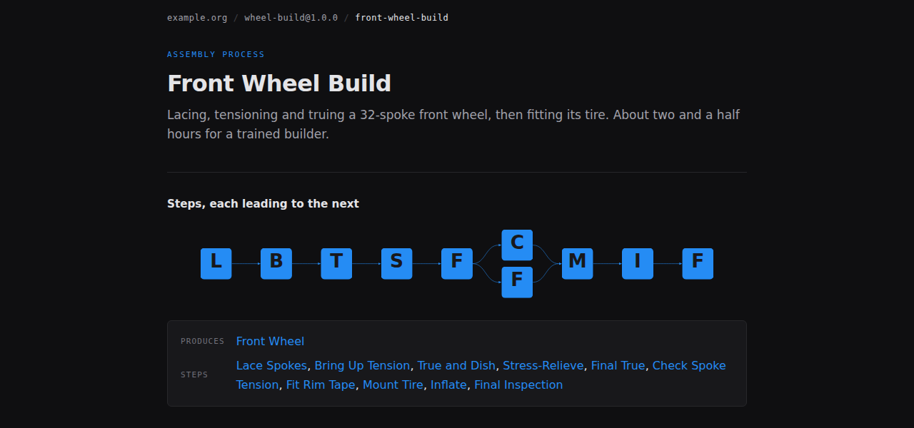
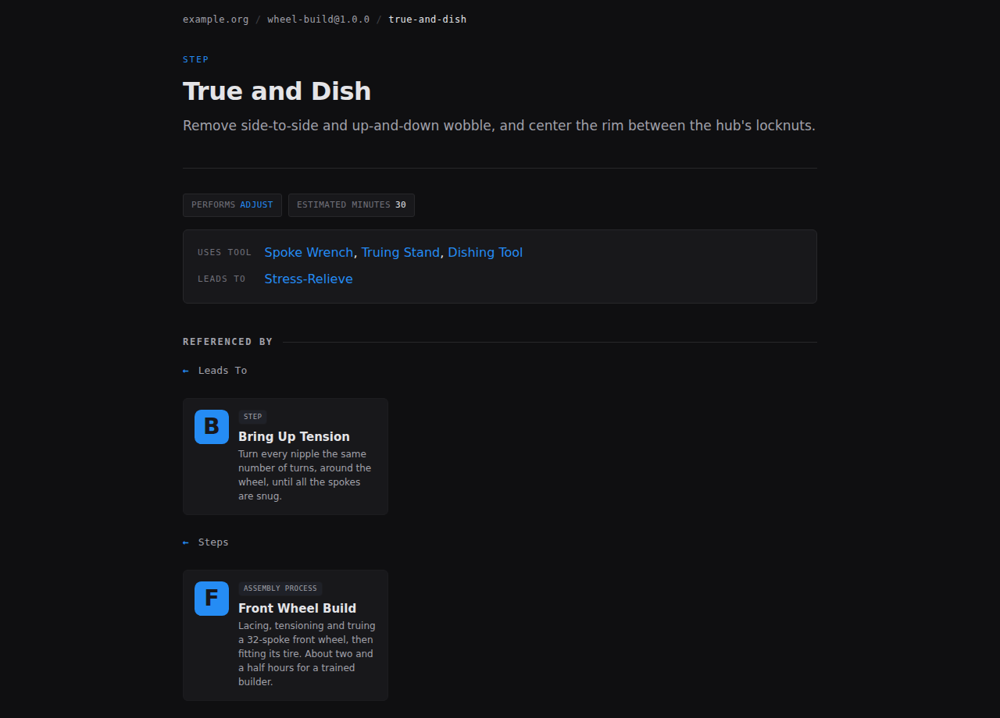
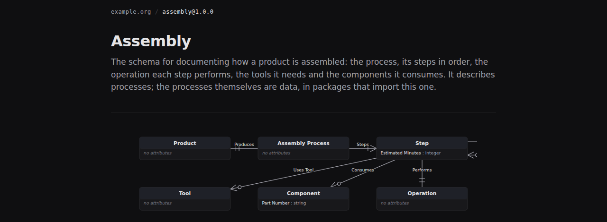

# Modelling a manufacturing process with Kanonak and Claude Code

A tutorial for someone who says: *"We're trying to model manufacturing processes, such as assembly processes involving
tools, components, steps, and so on."* You don't need to know what an ontology is yet. By the end you will have:

- **a schema** for assembly processes, which says what a process, a step, a tool and a component are and how they
  relate, checked by a validator;
- **one of your own processes**, written as data against that schema and checked the same way;
- **a site on your computer** where each process, step, tool and component is a page that links to the others;
- **enough understanding to show a colleague** how it all works, and to keep it growing.

It takes an afternoon. This folder holds a finished example, a bicycle wheel build, so you can see where you're heading
and compare your work with it at each step.



## Why an ontology, and why an AI agent

A process written in a document or a spreadsheet is text. "Uses the spoke wrench" is a phrase, and nothing knows that
the spoke wrench is a tool, that three steps use it, or that "spoke wrench" and "nipple wrench" are the same thing. An
**ontology** names each kind of thing once (a *class*, such as Step or Tool) and each relationship once (a *property*,
such as "a step uses a tool"), and says what each one means. Then every process you write is checked against it, and
questions such as "which steps use this tool?" or "which steps consume this part number?" have exact answers.

It's worth it when many processes share tools and components, when several people or teams must use the same words,
or when the processes change and you need to know what changed. For a one-off checklist, a document is fine.

The **Kanonak Protocol** writes an ontology as plain YAML files, versioned like software packages, which a validator
checks and a web server renders as pages. The format is precise, and learning it from its specifications takes days.
**Claude Code** with the Kanonak skill already knows it: you describe your domain, and it writes the files, runs the
validator, reads its errors and fixes them. You decide what the model means; it handles the syntax. This tutorial
teaches you to read what it writes, so you can tell when it's right.

## Part 1: Set up (15 minutes)

You need internet access, a terminal, and an account Claude Code can sign in with, which its setup page lists. The
commands work in PowerShell, Git Bash, macOS and Linux.

**1. Install Node.js 20 or later** from [nodejs.org](https://nodejs.org/en/download), then check it:

```bash
node --version
```

**2. Install the Kanonak CLI** (this tutorial was tested with 8.25.0):

```bash
npm install -g @kanonak-protocol/cli
kanonak --version
```

**3. Install Claude Code** as its [setup page](https://code.claude.com/docs/en/setup) says, then check it and sign in:

```bash
claude --version
claude
```

Type `/exit` to leave once you're signed in.

**4. Install the Kanonak Protocol skill**, which teaches Claude Code the protocol, the CLI and where the official guides
live (from [kanonak-protocol/skills](https://github.com/kanonak-protocol/skills)):

```bash
npx skills add kanonak-protocol/skills --skill kanonak-protocol --agent claude-code -g -y
```

`-g` installs it for every folder, in `~/.claude/skills/`, and `-y` answers its questions with the defaults.

**5. Get this example, check it and look at it:**

```bash
git clone https://github.com/kanonak-protocol/examples.git
cd examples/manufacturing-assembly
kanonak validate --conformance .
```

```
3 file(s) validated. 0 error(s), 0 warning(s), 0 info(s).

Conformance (sh:NodeShape and owl:hasKey evaluation over each document's import closure):
  conforms: true (no findings)
```

The first run fetches the protocol's own packages from `kanonak.org` and keeps them in `~/.kanonak`. Now serve the
folder as a site:

```bash
kanonak serve --publisher example.org --watch
```

Open <http://localhost:8080>, then these:

- <http://localhost:8080/wheel-build/1.0.0/front-wheel-build>, the process. Hover over a box in the diagram to see its
  step, and click it to open it.
- <http://localhost:8080/wheel-build/1.0.0/true-and-dish>, a step: what it does, how long it takes, its tools.
- <http://localhost:8080/wheel-build/1.0.0/spoke-wrench>, a tool, listing every step that uses it.
- <http://localhost:8080/assembly/1.0.0>, the schema, with a diagram of its classes and how they relate.

This is where you're heading. Press Ctrl+C in the terminal to stop the server.

## Part 2: Read the finished example (20 minutes)

Open the three files in an editor. Each is short. This part explains every kind of entry in them, which is all you
need to read what Claude Code writes for you later.

| Package | Kind | What it holds |
|---|---|---|
| `assembly/1.0.0.kan.yml` | schema | What an assembly process, a product, a step, a tool, a component and an operation are, and how they relate |
| `wheel-build/1.0.0.kan.yml` | data | One real process, built with the schema: a 32-spoke front bicycle wheel, in ten steps |
| `assembly-look/1.0.0.kan.yml` | look | How each kind of thing renders as a page |

**A package is one file per version**, named for its version, in a folder named for the package. The first entry is
the package's header: its name, its publisher, its version and what it imports. Here is the schema's, shortened:

```yaml
assembly:
  type: Package
  publisher: example.org
  version: 1.0.0
  imports:
    - publisher: kanonak.org
      packages:
        - { package: core-rdf,   match: ^, version: 1.2.0, alias: rdfs }
        - { package: core-shacl, match: ^, version: 1.8.0, alias: sh }
```

- **The publisher is a domain.** There's no central registry: each publisher serves its packages from its own domain.
  `example.org` is a placeholder, until you publish under a domain of your own (Part 8).
- **Everything has an address**, `publisher/package@version/name`. The Step class here is
  `example.org/assembly@1.0.0/Step`.
- **An import names another package and a version range.** `match: ^` with `version: 1.2.0` takes the newest 1.x
  version from 1.2.0 up. The alias is a short prefix local to this file: `rdfs.Class` means "the `Class` that
  `core-rdf` defines". The `kanonak.org` packages are the protocol's own vocabulary, borrowed from the W3C's
  standards: RDF for classes, OWL for properties, SHACL for rules.

**A class is a kind of thing.** It's named for one of its instances, in the singular, and its comment says what
belongs to it:

```yaml
Tool:
  type: rdfs.Class
  label: Tool
  comment: An instrument or fixture a step needs, which the step uses but does not consume.
```

**A property is a relationship**, from things of its *domain* to things of its *range*. An object property points at
another thing; a datatype property holds a value, such as a number:

```yaml
usesTool:
  type: owl.ObjectProperty
  domain: Step
  range: Tool
  label: Uses Tool
  comment: A tool the step needs.

estimatedMinutes:
  type: owl.DatatypeProperty
  domain: Step
  range: xsd.integer
  label: Estimated Minutes
  comment: How long the step takes a trained person, in whole minutes.
```

**A fixed list of choices is an enumeration.** Every step performs one of five operations, each defined once in the
schema, so a step can't name a sixth by mistake:

```yaml
Operation:
  type: rdfs.Class
  owl.oneOf: [ fit, fasten, tension, adjust, inspect ]

tension:
  type: Operation
  label: Tension
  comment: Brings a part to a working tension or torque.
```

**A shape is a rule about how many values a property takes.** This one says every step performs exactly one operation,
and has at most one estimate, of at least a minute:

```yaml
step-shape:
  type: sh.NodeShape
  sh.targetClass: Step
  sh.property:
    - { sh.path: performs, sh.minCount: 1, sh.maxCount: 1 }
    - { sh.path: estimatedMinutes, sh.maxCount: 1, sh.minInclusive: 1 }
```

**Data is instances of the schema's classes**, in a package of its own that imports the schema. A step names its
class, its operation, its components and tools, its time, and the step that comes next:

```yaml
true-and-dish:
  type: asm.Step
  label: True and Dish
  comment: Remove side-to-side and up-and-down wobble, and center the rim between the hub's locknuts.
  asm.performs: asm.adjust
  asm.usesTool: [ spoke-wrench, truing-stand, dishing-tool ]
  asm.estimatedMinutes: 30
  asm.leadsTo: stress-relieve
```

`asm.` is the alias this file gives the schema. `spoke-wrench` has no prefix, so it's defined in this same file, as a
`Tool` further down. The order of the steps comes from `leadsTo`, not from the order they're listed in: `final-true`
leads to two steps, which can happen in either order or at once, and the diagram shows them side by side.

**Keeping the schema and the data apart** is what lets one schema serve every process you'll ever write. A new process
is a new data package, and the schema changes only when your processes need something it can't yet say.

**A look says how a class renders.** Each page is a list of bands, top to bottom. Here a step shows a header, a row of
chips for its operation and time, a list of its tools, components and next steps, and every page that links to it:

```yaml
asm.Step:
  derivation.look:
    type: look.ResourceView
    look.bands:
      - type: look.Hero
        look.eyebrow: rdfs.type
        look.title: rdfs.label
        look.subtitle: rdfs.comment
      - type: look.ChipRow
        look.chips: [ asm.performs, asm.estimatedMinutes ]
      - type: look.ReferenceList
        look.entries: [ asm.usesTool, asm.consumes, asm.leadsTo ]
      - type: look.ReferencedBy
```



## Part 3: Learn to read the validator (10 minutes)

The validator is how you, and Claude Code, know a model is right. Make three mistakes on purpose, from the
`manufacturing-assembly` folder, and see what each says.

**A reference to something that doesn't exist.** In `wheel-build/1.0.0.kan.yml`, under `bring-up-tension`, change
`asm.usesTool: spoke-wrench` to `asm.usesTool: spoke-wrnch`, then validate:

```bash
kanonak validate --conformance .
```

```
example.org/wheel-build@1.0.0:
  ERROR: Reference to 'spoke-wrnch' in 'usesTool' could not be resolved
    -> The entity 'example.org/wheel-build/spoke-wrnch' is not defined in this namespace or any imported namespace.
  • Import the package that defines it, or check for a typo in 'spoke-wrnch'
```

A typo is an error, never a silent new name. Put `spoke-wrench` back.

**A missing value a shape requires.** Delete the line `asm.performs: asm.tension` under `stress-relieve`, and validate:

```
Conformance (sh:NodeShape and owl:hasKey evaluation over each document's import closure):
  VIOLATION: example.org/wheel-build/stress-relieve [performs] — 'performs' has 0 value(s); minCount is 1.
    -> kanonak.org/core-shacl/MinCountConstraintComponent (shape: step-shape)
  conforms: false (1 finding(s))
```

That's the `step-shape` rule from Part 2 at work. Put the line back.

**The wrong kind of thing.** Under `fit-rim-tape`, change `asm.consumes: rim-tape` to `asm.consumes: truing-stand`:

```
example.org/wheel-build@1.0.0:
  WARN: Property 'consumes' has range 'Component', but 'truing-stand' is a Tool, which is not Component or a subclass of it.
```

A step consumes components, and a truing stand is a tool. That's the property's range at work.

Undo all three with `git checkout -- .`, and validate once more to see it clean. When Claude Code builds your model, it
reads these same messages and fixes what they name. When you edit a file yourself, run the validator after each edit.

## Part 4: Build your own schema with Claude Code (30 minutes)

Make a folder for your own model, outside the example, and start Claude Code in it:

```bash
mkdir my-assembly
cd my-assembly
claude
```

Give it this, adapted to your domain. Starting with `/kanonak-protocol` loads the skill:

```
/kanonak-protocol I want to model how we assemble products: each assembly
process, the product it makes, its steps and which step leads to which,
what each step does, the tools it uses, the components it consumes and how
long it takes. Learn the Kanonak Protocol and its ontology conventions
first. Then ask me about my domain, one question at a time, before you
write anything. Then write the schema as a package named assembly,
publisher example.org, version 1.0.0, in assembly/1.0.0.kan.yml: classes,
properties and shapes only, and no data about my own processes yet.
Validate it with kanonak validate --conformance . and fix whatever it reports.
```

Answer its questions as you'd explain your work to a new colleague. It's your domain, so its first guess is a draft:
if it calls something a "Part" that your plant calls a "Component", or misses something that matters to you, such as
the workstation a step happens at, say so.

**Check what it wrote**, with Part 2 beside you:

- one class for each kind of thing, named in the singular for one of its instances;
- every property with a domain and a range;
- every class and property with a label, and a comment saying what it means;
- a shape wherever something must have exactly one value, or at least one;
- `kanonak validate --conformance .` shows 0 errors and `conforms: true`. Run it yourself.

Ask it why, wherever you'd have done something differently: "Why is Operation a fixed list?", "Why isn't the order of
the steps a number on each step?" Its reasons come from the protocol's
[ontology conventions](https://kanonak.org/ontology-conventions), which you can read too. Compare its schema with this
folder's `assembly/1.0.0.kan.yml`: yours will differ, and that's fine, as long as you can say what each entry means.

## Part 5: Describe your own process (30 minutes)

Now the real thing: one process your plant actually runs. In the same Claude Code session:

```
Interview me about one real assembly process we run, one question at a
time: what it produces, its steps and which step leads to which, what each
step does, the tools and components each step needs, and how long each
takes. Then write it as data in a second package, named after the process,
that imports the schema, and validate the folder. If my process needs
something the schema can't say yet, tell me, and change the schema first.
```

- **Start with one process of ten or so steps.** You can add the rest once you've seen it work. Its tools and
  components can live in its package for now. When a second process uses the same ones, ask Claude Code to move them
  into a package of their own that both processes import, and do it before you publish, since moving a thing changes
  its address.
- **Quantities**, such as two bearings or eight bolts, take a little more: ask Claude Code to model what a step
  consumes as a line holding a component and its quantity. As of CLI 8.25.0, a component's page doesn't yet list the
  steps that consume it through such a line, though a tool's page lists the steps that use it.
- **Steps that can happen in any order**, or at once, are steps that the same step leads to, as `final-true` leads to
  two.
- **When the schema can't say something**, such as a torque setting or a quality check's tolerance, that's the model
  growing: Claude Code adds a property to the schema, then uses it in the data. Check the new property as you checked
  the others.
- **No process at hand?** Describe something you know well, such as fitting a new chain to a bicycle or assembling a
  flat-pack bookcase, or read `wheel-build/1.0.0.kan.yml` again and write one like it.

## Part 6: Give it a look (15 minutes)

```
Learn the look conventions, then give the schema a look, in a third package
named assembly-look: a page for each process, with a diagram of its steps
in the order each leads to the next and a list of its product and steps; a
page for each step, with its operation and time as chips and lists of its
tools, components and next steps; a page for each tool and component that
lists the steps that use it; and a page for each product that names the
process that makes it. Validate the folder.
```

Compare what it writes with this folder's `assembly-look/1.0.0.kan.yml`. The look is attached to the schema's classes,
not to your data, so every process you add later renders the same way without another line. The protocol's
[look conventions](https://kanonak.org/look-conventions) list every kind of band.

## Part 7: Browse it (10 minutes)

Open a second terminal, so Claude Code keeps running in the first, and from your `my-assembly` folder:

```bash
kanonak serve --publisher example.org --watch
```

Open <http://localhost:8080>. It lists your packages; follow them to your process, then click through its steps, tools
and components. Every page is built from your files, and every link between two of your things is a property you
defined.

`--watch` reloads the site when a file changes. Ask Claude Code to change something, say "add a 'check torque' step
after fastening the housing", and reload the page to see it. If a page looks wrong, ask Claude Code to look at
<http://localhost:8080/.well-known/kanonak-render>, which lists what the renderer couldn't draw, and why.



## Part 8: Show your peers, and keep it growing

**A ten-minute demo** that shows what you've built:

1. Open your process's page, and walk through its diagram.
2. Click a tool, and show every step that uses it. Ask the room how long that list would take from your current
   documents.
3. Break something live, a typo in a step's tool, and run the validator: a mistake is caught before anyone reads it.
4. Search by meaning. It runs on your computer, once it has downloaded a small model (about 23 MB) the first time.
   In this example's folder:

   ```bash
   kanonak search -q "which tool measures spoke tension"
   ```

   ```
   Results for "which tool measures spoke tension":

     0.819  Tension Meter  (Tool)
            example.org/wheel-build/tension-meter
     0.652  Spoke Wrench  (Tool)
            example.org/wheel-build/spoke-wrench
     0.648  Check Spoke Tension  (Step)
            example.org/wheel-build/check-spoke-tension
   ```

5. Ask Claude Code a question about the process, such as "Which steps could two people do at once?", and show that it
   answers from the files.

**Share the folder** as you share code: put it in a git repository. A colleague clones it, installs the CLI, and runs
`kanonak validate --conformance .` and `kanonak serve --publisher example.org --watch`, as you did in Part 1.

**Publish it** when it should be read beyond your team. Change `example.org` to a domain you control, in each package's
`publisher` and in each import of your own packages, and in the `--publisher` you serve. Then:

```bash
kanonak release-lock
kanonak publish --out _site
```

`release-lock` records, beside each version, exactly which versions of its imports it was checked against, in a
`.kanonak.lock` file to commit with it. `publish` writes the same site `serve` shows, as static files in `_site`, with
each package's source beside its pages, which is what an import of it fetches. Serve `_site` at the root of your domain,
from any static web host, and anyone can import your schema by its address.

**Version it as it grows.** A published version never changes. To change one, add a new file beside it:

- **Adding** something, such as a new property or a new class, is a new minor version, `assembly/1.1.0.kan.yml`.
  Everything written against 1.0.0 still validates, and an import of `^1.0.0` takes 1.1.0 by itself.
- **Removing or renaming** something, or making an optional property required, breaks what was written against it, so
  it's a new major version, `assembly/2.0.0.kan.yml`. Each data package moves to it when its imports are changed to
  `2.0.0`. Add rather than remove wherever you can.

## What's in this folder

| Path | What it is |
|---|---|
| `assembly/1.0.0.kan.yml` | The schema: six classes, eight properties, five operations and three shapes |
| `wheel-build/1.0.0.kan.yml` | The sample process: a 32-spoke front wheel, its ten steps, seven components and seven tools |
| `assembly-look/1.0.0.kan.yml` | The look: a page for each process, step, tool, component and product, and the schema's own page |
| `images/` | The screenshots above, taken from `kanonak serve` |

## Troubleshooting

| Symptom | Fix |
|---|---|
| `kanonak: command not found` | Install the CLI (Part 1, step 2), then open a new terminal. |
| `validate` fails on network errors | Make sure you can reach `https://kanonak.org`. After one successful run, add `--offline`. |
| A page 404s under `kanonak serve` | Serve with `--publisher example.org`. Without it, every path starts with the publisher: `/example.org/wheel-build/1.0.0/front-wheel-build`. |
| Port 8080 is in use | Add `--port 8081`, and open that port instead. |
| Claude Code doesn't seem to know the protocol | Start your request with `/kanonak-protocol`, which loads the skill. If that isn't recognized, install the skill again (Part 1, step 4) and restart Claude Code. |
| `search -q` fails with an install hint | Its optional model runtime is missing. Run the command the hint prints. |
